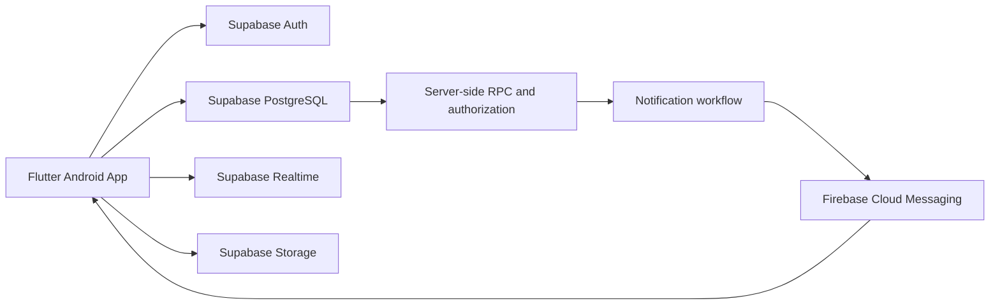

# Webix JO

**Digital services ordering, project tracking, and real-time client communication — in one Android application.**


## Download

**[Download the latest Android release](../../releases/latest)**

Webix JO is an academic final project and portfolio demonstration of a full-stack mobile application. This public repository is intended for app distribution and documentation only. The source code is not included.

## Features

| Area | Capabilities |
| --- | --- |
| Service ordering | Service catalog, custom requests, quotations and order tracking |
| Project management | Project milestones, status updates and customer–admin workflows |
| Real-time communication | Private chat, photos, voice messages, replies and reactions |
| CliQ workflow | Admin-issued payment requests through `@CliQ`, deposits, installments and manual transfer review |
| Notifications | In-app notifications and Firebase Cloud Messaging |
| Administration | Customer communication, order management, payment review and activity records |
| User experience | Arabic and English interfaces, light and dark themes |

## Architecture



The application separates client-side presentation from server-side authorization and persistence. The backend uses PostgreSQL row-level security and role-checked RPC functions to protect customer records and administrative workflows.

## Payment workflow

1. An administrator creates a payment request in the customer conversation using `@CliQ`.
2. The customer can review the requested amount, payment terms and recipient details.
3. The customer submits a transfer reference and, optionally, supporting proof.
4. The administrator reviews the transfer manually and records the result.

**CliQ transfers are external bank transfers, not an integrated payment gateway. The application does not move funds or verify them automatically. Do not send real money when evaluating this academic demonstration.**

## Installation

1. Open the [latest release](../../releases/latest).
2. Download the APK from the **Assets** section.
3. Open the APK on an Android device running Android 7.0 or later.
4. If Android requests permission to install apps from your browser or file manager, enable it only for the installation source you trust.
5. Install the application and launch Webix JO.

Internet access is required for connected features. Notification and microphone access support push notifications and voice messages respectively.

## Technical details

| Item | Value |
| --- | --- |
| Version | 1.0.0 |
| Application ID | `com.webixjo.app` |
| Minimum Android | Android 7.0 (API 24) |
| Target Android API | 36 |
| Architectures | ARM64, ARMv7, x86_64 |
| Frontend | Flutter / Dart |
| Backend | Supabase / PostgreSQL |
| Notifications | Firebase Cloud Messaging |

### Verification

During development, `flutter analyze` reported no issues and the Flutter test suite passed 133 tests. Phase 18 database migration checks passed. These checks do not replace device-level acceptance testing or a complete independent security audit.

### APK integrity

SHA-256 for the supplied v1.0.0 APK:

```text
f23ceb6375c081cf36c63522f734c951669121488b88844114135259e080d61c
```

## Project status and ownership

Developed by **Abdalrahman Yousef Alqashi** as a final course project and portfolio application.

Webix JO is proprietary software. All rights reserved. The public repository distributes the compiled application and project documentation; it does not grant access to the source code or a license to redistribute or modify the software.

